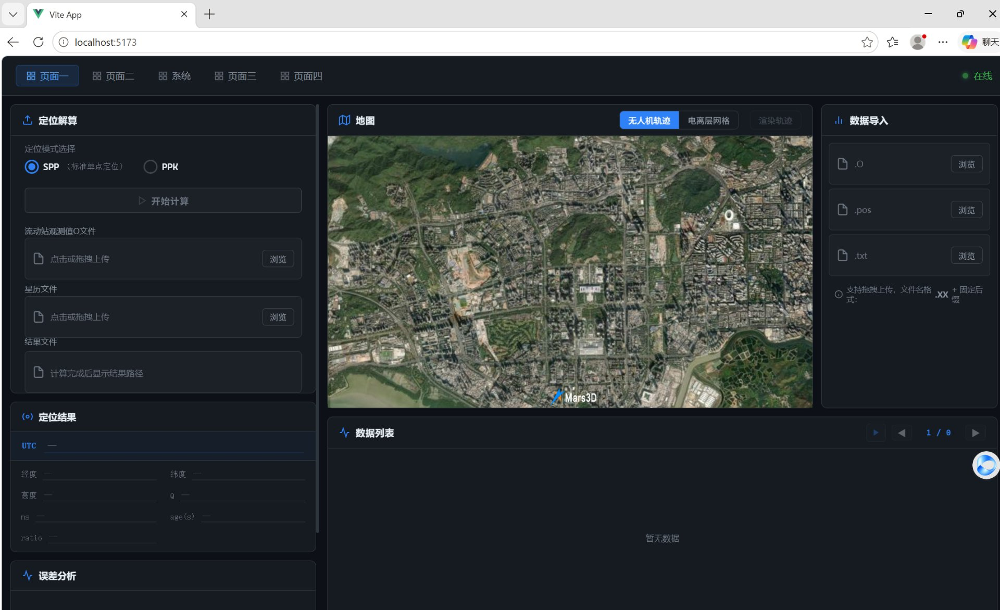

# GNSS 定位数据处理控制台

一个面向 GNSS 观测数据的**定位解算 + 三维轨迹可视化** Web 控制台：前端负责数据导入、轨迹渲染与电离层网格展示，后端负责调度定位解算核心（SPP / PPK）并把解算结果回传给前端。



<p align="left">
  <a href="https://github.com/nanheer/gnss-positioning-console/actions/workflows/backend.yml"></a>
  <a href="https://github.com/nanheer/gnss-positioning-console/actions/workflows/frontend.yml"></a>
  <a href="LICENSE"></a>
</p>

---

## 功能特性

**定位解算**

- 支持 **SPP**（单点定位）与 **PPK**（动态后处理差分）两种模式
- PPK 可选填写基准站坐标（纬度 / 经度 / 高程），留空则由解算程序自行解算基准站坐标
- 上传后一键调用解算程序，自动回收 `.pos` 结果并注入前端，无需手动找文件
- 解算在独立会话目录中执行，支持超时控制与结果文件归一化

**三维可视化**

- 基于 Mars3D / Cesium 的三维地球，支持影像、街道、地形、深色、Voyager、OSM 多种底图切换
- `.pos` 轨迹渲染：解析解算结果，按经纬高绘制飞行轨迹，自动飞到轨迹范围中心
- 电离层 TEC 网格：读取 `.txt` 插值文件，按经纬度网格着色并显示 TEC 色标，支持时次自动切换
- 数据列表：历元级浏览、播放/暂停、上一条/下一条，虚拟滚动支撑大数据量
- 参数曲线：经纬度、高程、精度因子等指标随时间变化的图表

**数据导入**

- 观测文件：`.o` / `.obs` / 年份型后缀（如 `.26O`）
- 结果文件：`.pos`
- 电离层插值文件：`.txt`（按 12 个时次 × 30 行 × 60 列组织）

---

## 架构

```
┌──────────────────────────────┐        HTTP         ┌──────────────────────────────┐
│  frontend  (Vue 3 + Vite)     │  /api/solver/*      │  backend (Spring Boot 2.7)   │
│  · 数据导入 / 解析             │ ──────────────────▶ │  · 会话目录管理               │
│  · 三维地图 / 轨迹渲染          │                     │  · 进程调度解算核心            │
│  · 图表 / 数据列表              │ ◀────────────────── │  · 结果文件归一化 / 下载        │
└──────────────────────────────┘    multipart/JSON    └──────────────┬───────────────┘
                                                                    │ ProcessBuilder
                                                                    ▼
                                                     ┌──────────────────────────────┐
                                                     │ 解算核心（position.exe）       │
                                                     │ 统一的命令行参数约定           │
                                                     └──────────────────────────────┘
```

定位解算由独立的可执行程序 `position.exe` 完成，后端只负责参数拼装、进程调度与结果回收，两者通过命令行约定衔接。仓库随附 `tools/position.exe` 作为可直接运行的解算核心；你也可以用同样的参数约定接入自己编译的版本，只需把配置项 `solver.exe-path` 指向新的程序。

---

## 目录结构

```
gnss-positioning-console/
├── backend/                 # Spring Boot 后端（Maven 工程）
│   ├── pom.xml
│   └── src/main/java/com/gnss/console/
│       ├── config/          # 跨域配置
│       ├── controller/      # REST 接口
│       ├── dto/             # 请求 / 响应对象
│       └── service/         # 解算调度、进程调用、结果处理
├── frontend/                # Vue 3 前端（Vite 工程）
│   └── src/
│       ├── api/             # 接口封装
│       ├── components/      # 地图、图表、数据列表、上传等组件
│       ├── page/            # 页面布局
│       ├── static/          # 示例区域边界数据
│       └── store/           # Pinia 状态与文件解析
├── samples/                 # 示例观测数据（见 samples/README.md）
├── tools/                   # 示例解算程序（见 tools/README.md）
├── scripts/                 # 一键启动脚本（Windows）
└── docs/                    # 架构说明、接口文档
```

---

## 快速开始

### 环境要求

| 组件 | 版本 |
| --- | --- |
| JDK | 11 及以上 |
| Maven | 3.6 及以上 |
| Node.js | 20.19+ 或 22.12+ |
| 系统 | Windows / Linux / macOS（示例脚本为 Windows） |

### 1. 启动后端

```bash
cd backend
mvn clean package -DskipTests

# 解算程序需要与 jar 在同一目录（或通过 --solver.exe-path 指定绝对路径）
cp ../tools/position.exe target/
java -jar target/gnss-solver-1.0.0.jar
```

服务启动后监听 `http://localhost:8080`，健康检查：

```bash
curl http://localhost:8080/api/solver/health
# OK
```

> 也可以在 `backend/src/main/resources/application.yml` 里把 `exe-path` 改成绝对路径，或用启动参数覆盖：
> `java -jar gnss-solver-1.0.0.jar --solver.exe-path=D:/path/to/position.exe`

### 2. 启动前端

```bash
cd frontend
npm install
npm run dev
```

浏览器打开 `http://localhost:5173/`。开发环境下 `/api/solver` 会被代理到 `http://localhost:8080`，如需改后端地址：

```bash
VITE_BACKEND_URL=http://192.168.1.10:8080 npm run dev
```

生产构建：

```bash
npm run build     # 产物在 dist/
```

---

## 使用说明

### 数据导入

右侧「数据导入」三个槽位分别对应：

| 槽位 | 文件 | 说明 |
| --- | --- | --- |
| `O` | 观测文件 | `.o` / `.obs` / `.26O` 等，用于数据列表与图表 |
| `pos` | 解算结果 | `.pos`，用于地图轨迹渲染 |
| `txt` | 电离层插值 | 12 时次 × 30 行 × 60 列，用于电离层网格着色 |

### SPP 解算

1. 左侧「定位解算」选择 **SPP**
2. 上传流动站观测文件（`.O`）与星历文件（`.nav`）
3. 点击「开始计算」，成功后自动载入结果
4. 地图上方切到「无人机轨迹」并点击「渲染轨迹」

### PPK 解算

1. 选择 **PPK**
2. 依次上传 **流动站观测文件 → 基准站观测文件 → 星历文件**（顺序不可颠倒，第一个观测文件被视为流动站）
3. 可选填写基准站坐标，格式为 **纬度 经度 高程**
4. 点击「开始计算」→「渲染轨迹」

### 电离层网格

先上传 `.txt` 电离层文件，再点击地图上方的「电离层网格」。不配置外部网格服务时，网格几何由前端按经纬度范围本地生成（30 × 60，与 `.txt` 行列一一对应）。

---

## 配置项

### 后端 `application.yml`

```yaml
server:
  port: 8080

solver:
  # 解算程序路径；相对路径以 jar 所在目录为基准
  exe-path: ./position.exe
  # 会话临时目录；相对路径以 jar 所在目录为基准
  temp-dir: ./temp
  # 解算超时（秒）
  timeout: 600
  # 结果文件归一化后的文件名
  output-file: rover.pos
```

### 前端环境变量

复制 `frontend/.env.example` 为 `frontend/.env.local` 后按需修改：

| 变量 | 说明 |
| --- | --- |
| `VITE_BACKEND_URL` | 后端地址，默认 `http://localhost:8080` |
| `VITE_GRID_API_BASE` | 可选。外部网格几何服务地址；留空则使用前端本地生成 |
| `VITE_GRID_API_TOKEN` | 可选。外部网格服务的鉴权 token |

### 解算程序参数

后端按下述规则拼装命令行，可据此接入任何参数兼容的程序：

```bash
# SPP：流动站观测 + 星历
position.exe rover.o base.nav

# PPK：流动站观测 + 基准站观测 + 星历
position.exe rover.o base.o base.nav

# PPK + 基准站坐标（纬度 经度 高程）
position.exe rover.o base.o base.nav -c 22.5913 113.9669 27.8681
```

约定：**输出文件名为第一个输入文件的主名 + `.pos`**（如 `base.o` → `base.pos`）。后端会把它归一化为配置的输出名，保证下载接口始终可用。

完整接口说明见 [docs/API.md](docs/API.md)，架构说明见 [docs/ARCHITECTURE.md](docs/ARCHITECTURE.md)。

---

## 常见问题

**1. 计算失败：`Cannot run program "...\position.exe" ... CreateProcess error=2`**

后端找不到解算程序。检查 `exe-path` 是否正确；若使用相对路径，它是以 **jar 所在目录** 为基准解析的（不是启动命令时的工作目录）。建议把 `position.exe` 与 jar 放在同一目录。

**2. 提示「计算成功」，但结果为空 / 地图没有轨迹**

解算程序的输出文件名跟随第一个输入文件（`base.o` → `base.pos`）。后端已做归一化处理；如果你自行修改过下载逻辑，请确认取的是实际生成的 `.pos`，而不是固定的 `rover.pos`。

**3. 填了基准站坐标但结果没有变化**

`-c` 后的三个数字顺序必须是 **纬度 经度 高程**。顺序颠倒时程序可能静默忽略该参数。

**4. 轨迹看起来不连续 / 点数很少**

这与解算程序内部的输出率、整周模糊度策略有关：不同解算器对同一份数据的历元数与固定解比例可能差异很大（本项目实测可相差 4 倍点数）。控制台如实展示解算结果，不会插值补点。

**5. 电离层网格不显示**

需要先上传 `.txt` 电离层文件；若配置了 `VITE_GRID_API_BASE`，还需保证该服务可访问且允许跨域。

---

## 数据说明

`samples/` 中的观测数据仅用于演示与自测，来自单次实测采集：

| 文件 | 大小 | 说明 |
| --- | --- | --- |
| `base.nav` | 33 KB | 星历文件 |
| `base.o` | 2.1 MB | 基准站观测文件 |
| `rover.o` | 45 MB | 流动站观测文件（长时段，解算耗时较长） |

想快速验证链路，建议先用 `base.o + base.nav` 跑 SPP（数秒出结果）。

> 提示：`rover.o` 体积较大，若仓库克隆较慢，可在自己的 fork 中删除该文件（SPP 演示不受影响）。

---

## 开发与贡献

欢迎提交 Issue 与 Pull Request，详见 [CONTRIBUTING.md](CONTRIBUTING.md)。

```bash
# 后端
cd backend && mvn test

# 前端
cd frontend && npm run build
```

## 致谢

本项目的实现依赖以下开源项目：

- [Vue 3](https://vuejs.org/) / [Vite](https://vite.dev/) / [Pinia](https://pinia.vuejs.org/)
- [Mars3D](https://mars3d.cn/) / [CesiumJS](https://cesium.com/platform/cesiumjs/) — 三维地球与地理可视化
- [Apache ECharts](https://echarts.apache.org/) — 图表
- [Spring Boot](https://spring.io/projects/spring-boot) / [Hutool](https://hutool.cn/)

> Mars3D 为第三方库，商业用途请遵守其自身的授权条款。`tools/position.exe` 为随仓库分发的示例解算程序，正式环境可替换为自建版本，只要保持下述命令行约定即可。

## 许可证

[MIT](LICENSE)
